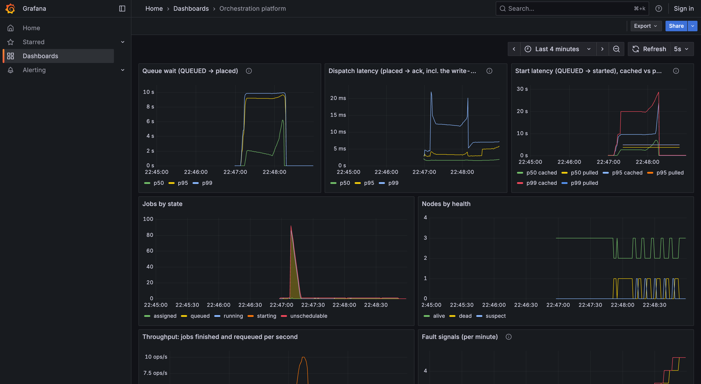

# orchestration-platform

A small distributed compute orchestrator: a C++20 coordinator schedules container jobs
onto Python worker agents over WebSockets, with capability-aware placement, at-least-once
execution with attempt fencing, and Prometheus/Grafana observability.

The design, its trade-offs and the decision log are in [docs/DESIGN.md](docs/DESIGN.md);
the worker protocol is in [proto/PROTOCOL.md](proto/PROTOCOL.md).

> **Status:** scheduling, the job state machine, end-to-end execution, worker failure
> detection and coordinator crash recovery work, and are benchmarked below.

## Results

**Setup: a single host over loopback.** Apple M4 Pro, macOS 15.3, Docker Desktop
29.6 (Linux VM with 14 CPUs and 8 GB). The coordinator (release build), 3 workers
(5 slots) and the job containers all run on that one machine, so network latency
is not included. Job state is persisted with SQLite (`synchronous=FULL`) on the
Docker VM's disk. One run of [`bench/bench.py`](bench/bench.py) at `455aded`:

| Scenario | Metric | n | p50 | p95 | p99 |
|---|---|---|---|---|---|
| Idle (one job at a time) | Dispatch (placed → `ack`, incl. fsync) | 50 | 1.31 ms | 2.52 ms | 4.28 ms |
| | Start, cached image (queued → `started`) | 50 | 105 ms | 121 ms | 128 ms |
| Burst (100 jobs onto 5 slots) | Queue wait (queued → placed) | 100 | 4.63 s | 9.14 s | 9.64 s |
| | Dispatch | 100 | 1.69 ms | 3.59 ms | 14.6 ms |
| Cold start (image pulled) | Start, pulled image | 10 | 3.03 s | max 3.80 s | |
| Worker crash (`docker kill`) | Time to reassign | 5 | 108 ms | max 112 ms | |
| Worker hang (`docker pause`) | Time to detect / to reassign | 5 | 4.82 / 4.82 s | max 4.82 / 4.82 s | |

- **Percentiles are exact** (nearest rank) over the coordinator's own per-attempt
  nanosecond samples. With fewer than 100 samples, p99 is the maximum, and rows
  with 5 or 10 samples show only the median and the maximum. All tables, raw
  samples and the method: [bench/results/latest.md](bench/results/latest.md),
  [bench/README.md](bench/README.md).
- **Dispatch includes the write-ahead commit.** An `assign` leaves only after the
  assignment is fsynced (DESIGN.md §8.2), which is most of dispatch's ~1.3 ms, and the
  burst's 14.6 ms p99 (max 24.9 ms) is that fsync's tail. Group commit keeps one fsync
  per batch of events rather than one per event. Without persistence, the same
  benchmark measured 0.29 ms p50 (results in `bench/results/`).
- **Under the burst, the backlog shows up as queue wait**, a capacity question, while
  dispatch stays in milliseconds. Submissions ran at 423/s, because a `201` is sent
  only once the job is on disk.
- **A cached start is about 100 ms, almost all Docker** creating and starting the
  container. A cold start adds the registry pull, so it depends on the network.
- **Crash numbers are dominated by the `docker kill` command itself** (about 105 ms;
  reported in its own row in the full results). The socket closing is noticed almost
  immediately.
- **Hang detection is about 4.8 s here, but in general can fall anywhere from about
  4 s to 5 s.** A node is declared dead 5 s after its *last heartbeat*, and heartbeats
  are 1 s apart, so the time from a hang to its detection depends on where in that
  interval the hang starts. This run's five samples happened to land at almost the
  same point, so their spread is a few milliseconds; expect up to about 1 s in general.



*The dashboard during that run, in order: burst, cold starts, crashes, hangs. Its
quantiles are `histogram_quantile()` estimates over a 1-minute window; the table
above is exact. For example, during the burst the start-latency p99 reads about
20 s, while the slowest start was 10.05 s: samples just over 10 s fall into the
10–30 s histogram bucket, and the estimate interpolates inside that wide bucket.*

## Demo (about 5 minutes)

Needs Docker with Compose v2, `curl` and `jq`. Ports 8080, 9090 and 3000 must be free.

**1. Start the stack** (coordinator, three workers, Prometheus, Grafana):

```sh
export CLUSTER_TOKEN="$(openssl rand -hex 32)"
docker compose up --build -d
```

The first build compiles the coordinator's dependencies and takes a few minutes.

**2. See the workers** (two CPU nodes, one simulated CUDA node):

```sh
curl -s localhost:8080/v1/nodes | jq -c '.nodes[] | {node_id, health, slots, accelerator: .capabilities.accelerator}'
```

**3. Run a job and look at it:**

```sh
JOB=$(curl -s localhost:8080/v1/jobs \
  -d '{"image": "alpine:3.20", "command": ["sh", "-c", "echo hello from orch"]}' | jq -r .job_id)
sleep 3
curl -s localhost:8080/v1/jobs/$JOB | jq '{state, exit_code, attempts}'
```

`attempts` shows the node and the exact queue wait, dispatch and start latency in nanoseconds,
and whether the image had to be pulled. The job's output is in
`docker compose logs worker-cpu worker-cpu-2`.

**4. Open Grafana** at <http://localhost:3000> (no login), then submit a burst of 30
short jobs and watch the panels fill in:

```sh
for i in $(seq 30); do
  curl -s localhost:8080/v1/jobs -d "{\"image\": \"alpine:3.20\", \"command\": [\"sleep\", \"$((i % 3 + 1))\"]}" > /dev/null
done
curl -s localhost:8080/v1/jobs | jq -r '.jobs | group_by(.state)[] | "\(.[0].state): \(length)"'
```

Five slots in total, so the burst queues up and drains in about 15 s. Run the last
command a few times to watch jobs move from `queued` through `running` to `succeeded`.
The latency panels are `histogram_quantile()` estimates over a 1-minute window.

The burst shows up in **queue wait** (seconds: jobs waiting for a free slot), while
**dispatch latency** (assign sent → ack) stays small. DESIGN.md §11 defines all three.

**5. A few more things to try:**

```sh
# A cold start: remove an image first, and the start latency is labelled "pulled".
docker image rm -f busybox:1.37 2>/dev/null
curl -s localhost:8080/v1/jobs -d '{"image": "busybox:1.37", "command": ["true"]}' | jq -r .job_id

# A CUDA job goes only to the (simulated) CUDA node.
curl -s localhost:8080/v1/jobs -d '{"image": "alpine:3.20", "command": ["true"],
  "requirements": {"accelerator": "cuda", "min_gpu_mem_mb": 16384}}' | jq -r .job_id

# No MPS node is connected, so this one waits as "unschedulable" instead of "queued".
curl -s localhost:8080/v1/jobs -d '{"image": "alpine:3.20", "command": ["true"],
  "requirements": {"accelerator": "mps"}}' | jq '{job_id, state}'

# Failures are reported, not retried: a non-zero exit, and a job over its time limit.
curl -s localhost:8080/v1/jobs -d '{"image": "alpine:3.20", "command": ["sh", "-c", "exit 3"]}' | jq -r .job_id
curl -s localhost:8080/v1/jobs -d '{"image": "alpine:3.20", "command": ["sleep", "30"], "max_runtime_s": 2}' | jq -r .job_id

# Cancel a running job (its container is killed).
JOB=$(curl -s localhost:8080/v1/jobs -d '{"image": "alpine:3.20", "command": ["sleep", "60"]}' | jq -r .job_id)
sleep 2; curl -s -X POST localhost:8080/v1/jobs/$JOB/cancel | jq '{state, reason}'
```

**6. Stop it:** `docker compose down` (job history is kept in the `orch-data` volume; add `-v` to wipe it).

To record the demo as a GIF, run [`deploy/demo.sh`](deploy/demo.sh) (a narrated,
paced version of the steps above) through [VHS](https://github.com/charmbracelet/vhs):
`vhs docs/demo.tape`.

## Known limitations

- **A crashed worker leaves its job container behind.** If a worker process dies
  (for example `docker kill`), the job container it started keeps running until its
  command ends and is then left stopped, because only the worker removes it. The job
  itself is requeued and completes elsewhere. The bench removes these leftovers and
  counts them (one per crash). Cleaning them up when the worker restarts is future work.
- **Recovery assumes the database survives.** Job state is fsynced to one SQLite
  file. Losing that disk loses the jobs (DESIGN.md §8.4).
- **One coordinator** is a single point of failure: scheduling stops while it is down
  (DESIGN.md §8.4).
- **Hang detection takes 4–5 s** by default (DESIGN.md §10). Shorter timeouts recover
  faster but declare slow workers dead more often; both are flags.

## Security notes

- **The workers mount the host's Docker socket** to start job containers. Anything
  that can use that socket is root-equivalent on the host, so this stack is for a
  local demo only.
- Every port is published on `127.0.0.1`. Grafana is read-only and anonymous.
- **REST has no auth.** By default it shares a port with the worker WebSocket. Run the
  coordinator with `--admin-port N` to move REST and `/metrics` to their own port, which
  must stay private; `--port` then serves only workers and `/healthz` (DESIGN.md §7.4).
- **Jobs only run outside a container if you ask.** A worker uses the `docker` runtime and
  exits with code 2 if Docker isn't reachable. The `process` runtime, needed for MPS, has
  no isolation and must be requested in a profile: `"runtimes": ["process"]`.
- Workers authenticate with a shared token, which reaches containers as a Compose
  secret file, never as a command-line flag or a container environment variable.
  Traffic is plain `ws://` and `http://`; TLS is out of scope (DESIGN.md §1).

## API

| Method & path | |
|---|---|
| `POST /v1/jobs` | Submit `{image, command, requirements?, max_runtime_s?, max_retries?, idempotency_key?}`. `201`, or `200` with the original job on an idempotency-key replay. |
| `GET /v1/jobs?state=` | List jobs, optionally by state. |
| `GET /v1/jobs/{id}` | One job, with per-attempt latencies. |
| `POST /v1/jobs/{id}/cancel` | Idempotent; `409` if the job already finished otherwise. |
| `GET /v1/nodes` | Workers with capabilities, load and health. |
| `GET /metrics`, `GET /healthz` | Prometheus exposition; liveness. |

## Development

```sh
# Coordinator (C++20, CMake + vcpkg manifest mode; VCPKG_ROOT must point at vcpkg)
cd coordinator && cmake --preset debug-asan && cmake --build --preset debug-asan \
  && ctest --preset debug-asan

# Worker unit tests and integration tests (against the debug-asan coordinator)
python -m venv .venv && .venv/bin/pip install -e "worker[test]" -r tests/integration/requirements.txt
.venv/bin/python -m pytest worker/tests tests/integration

# The whole stack, checked end to end
deploy/smoke.sh
```

CI runs all of the above, plus TSan and a macOS build.
