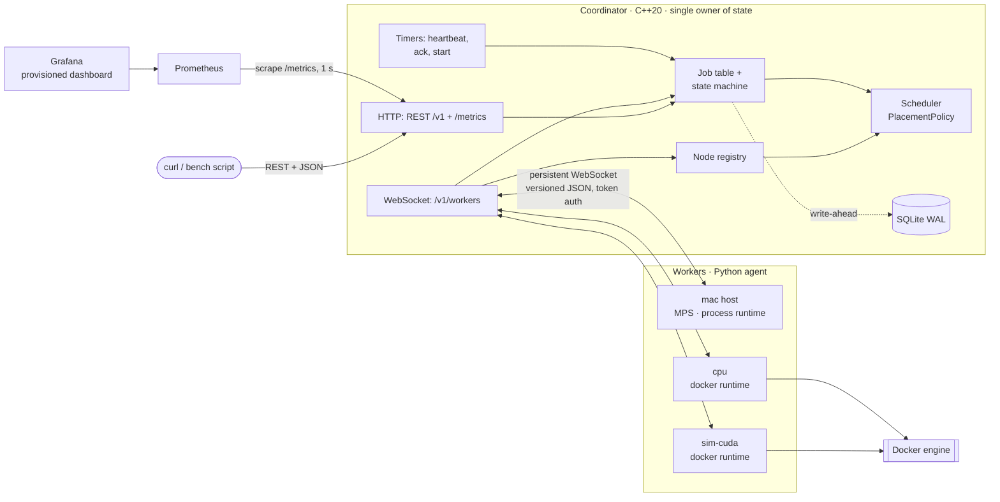
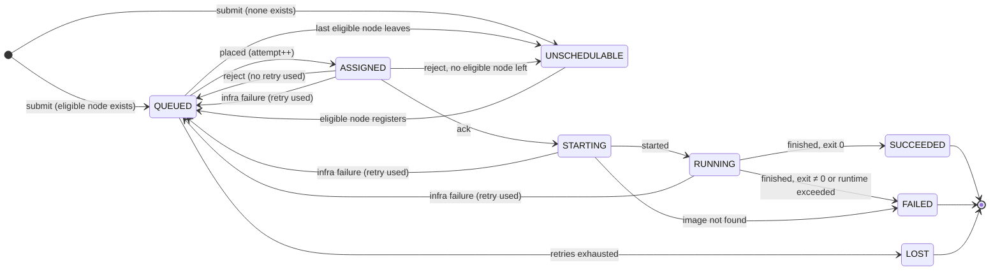

# Design: Distributed Compute Orchestration Platform (v2)

Status: **Draft — milestone 1**. Guiding priorities: **maturity and simplicity**. Every
component here earns its place; anything that doesn't is listed as a non-goal.

## 1. Goals and non-goals

**Goals**

- Schedule containerized jobs across a heterogeneous cluster (Apple Silicon/MPS,
  NVIDIA/CUDA, CPU-only) with capability-aware placement.
- Survive worker failure: detect it, requeue its jobs within a retry budget, and never
  *silently* accept a job's result twice.
- Survive coordinator restart: recover queued and in-flight jobs from disk.
- Make two claims measurable, with p50/p95/p99 from scripts committed in `bench/`:
  - **Dispatch latency** under 100 ms (defined in §10).
  - **Fault-tolerant reassignment**: a job on a killed worker completes elsewhere.

**Non-goals (v2)**

- Coordinator high availability (discussed in §8.4, not built).
- Kubernetes/Helm. Deployment is Docker Compose only (coordinator, workers,
  Prometheus, Grafana).
- Warm container pools. Start latency is reported honestly for cold and cached images.
- Multi-tenancy, user auth on the REST API, TLS. The REST API is meant for a trusted
  network (Compose network / localhost); workers authenticate with a shared token (§7.3).
- Multi-node (gang-scheduled) jobs; priorities; preemption.

## 2. Lessons from the MVP

| MVP behaviour | v2 response |
|---|---|
| Workers poll every 2 s → ~1 s average wait before a job is even seen | Coordinator **pushes** assignments over a persistent WebSocket |
| Heartbeats blocked while a job ran (single-threaded worker) | Heartbeats run on their own asyncio task |
| Jobs on an offline machine were marked *failed*, never retried | Requeue with a retry budget (§5) |
| Result handling was read-check-write (race between concurrent posts) | All state on one thread; terminal transition happens once (§6) |
| No distinction between "job crashed" and "machine died" | Infrastructure failures retry; job failures don't (§5) |
| AST blocklist as sandbox | Docker isolation (and an explicit non-goal for hostile code) |

## 3. Architecture



**Single binary, single port.** The coordinator serves REST, `/metrics`, and the worker
WebSocket endpoint (HTTP upgrade on `/v1/workers`) from one Boost.Beast listener.

**Request path for one job:** `POST /v1/jobs` → job committed as `QUEUED` → `201` →
scheduler picks a node → assignment committed (`attempt = n`) → `assign` pushed → worker
`ack` (**dispatch latency ends**) → worker starts the container → `started`
(**start latency ends**) → … → `finished`.

## 4. Components

### 4.1 Coordinator (C++20)

| Module | Responsibility |
|---|---|
| `net` | Beast listener; routes plain HTTP to `api`, upgrades `/v1/workers` to a `WorkerSession`. |
| `protocol` | Message types, JSON encode/decode, version check. Pure functions, unit-tested. |
| `api` | REST handlers (§7.1). Thin: validate, call into `jobs`, serialise. |
| `registry` | Connected nodes: capabilities, slots, running jobs, health. |
| `jobs` | Job table and the state machine (§5). The only code that changes job state. |
| `scheduler` | `PlacementPolicy` interface + one implementation (§4.3). Pure logic. |
| `store` | SQLite persistence on its own thread (§8). |
| `metrics` | Counters, gauges and histograms, Prometheus text format (§12). |

`jobs`, `registry`, `scheduler` and `protocol` have no I/O and take time as a parameter,
so the state machine is tested deterministically with no sockets and no sleeps.

### 4.2 Worker agent (Python, asyncio)

- Detects capabilities: CPU cores, RAM, MPS (`torch.backends.mps.is_available()`), CUDA
  device and memory (`torch.cuda`), or loads a **simulated profile** from a file.
- Two runtimes:
  - `docker`: runs the job's image via the Docker SDK.
  - `process`: runs the command as a native subprocess. Needed because **Docker on
    macOS runs a Linux VM and cannot expose MPS**; real MPS jobs run on the Mac host.
- Tasks: connection (reconnect with exponential backoff + jitter), heartbeats, one task
  per running job. A long job can never delay a heartbeat.
- Enforces each job's `max_runtime_s`.

**Hardware plan (Mac only):** one native worker on the Mac host advertises real MPS;
in Compose, a `cpu` worker and a `sim-cuda` worker advertise their profiles and run CPU
containers. The README labels the CUDA node as simulated.

In Compose, worker containers mount the host Docker socket and launch jobs as sibling
containers. That socket is root-equivalent on the host; acceptable for a local demo,
called out in the README.

### 4.3 Scheduling policy

One policy, **least-loaded with capability matching**, behind an interface:

```cpp
struct PlacementPolicy {
    virtual ~PlacementPolicy() = default;
    // Returns the chosen node, or nullopt if no feasible node has a free slot.
    virtual std::optional<NodeId> place(const JobSpec&, std::span<const NodeView>) const = 0;
};
```

1. **Filter** to feasible nodes: health `ALIVE`; accelerator matches (`cpu` jobs may run
   anywhere, `cuda`/`mps` only on matching nodes); `gpu_mem_mb ≥ min_gpu_mem_mb`; at
   least one free slot; not in the job's `rejected_by` set (§5.3).
2. **Choose** the lowest `running / slots`; ties broken by node ID (deterministic, so
   tests are stable).

The queue is scanned in FIFO order and **skips** jobs that can't be placed right now,
so a CUDA job waiting for the busy GPU node doesn't block CPU jobs behind it. Trade-off:
a large job can be bypassed repeatedly (starvation); acceptable without priorities, and
visible as a job that stays `QUEUED` in `GET /v1/jobs` while others pass it.

## 5. Job model and state machine

### 5.1 Fields

`job_id` (UUID v4), optional `idempotency_key`, `image`, `command`,
`requirements {accelerator: cpu|cuda|mps, min_gpu_mem_mb}`, `max_runtime_s`,
`max_retries` (default 2), `attempt` (fencing token, §6), `retries_used`
(retry budget, §5.3), `rejected_by` (node IDs, §5.3), `assigned_node`, `state`,
`reason`, timestamps.

### 5.2 States

| State | Meaning | Timer |
|---|---|---|
| `QUEUED` | An eligible node exists; waiting for a free slot | — |
| `UNSCHEDULABLE` | **No eligible node is connected**; waiting for one to join | — |
| `ASSIGNED` | `assign` sent; waiting for `ack` | `T_ack` (default 2 s) |
| `STARTING` | Acked; worker is pulling the image / creating the container | `T_start` (default 120 s) |

An **eligible** node is connected, has the job's required capabilities, and is not in the
job's `rejected_by` set (§5.3). Both timers are configurable (`--ack-timeout`,
`--start-timeout`). `T_start` is generous because pulling a large CUDA image can
take more than a minute.
| `RUNNING` | Worker reported `started` | none (worker enforces `max_runtime_s`) |
| `SUCCEEDED` / `FAILED` / `LOST` / `CANCELLED` | Terminal | — |

`QUEUED` vs `UNSCHEDULABLE` separates "waiting for **capacity**" from "waiting for
**capability**". A CUDA job submitted to a cluster without a CUDA node would otherwise
sit in the queue forever with nothing to say why.



`CANCELLED` is reachable from every non-terminal state (omitted above for legibility);
if the job is on a worker, the coordinator also sends `cancel(job_id, attempt)`.
After any return to `QUEUED`, the eligibility check runs again, so a requeued job may
land in `UNSCHEDULABLE`.

### 5.3 Failure classification and the retry budget

| Event | Classified as | Consumes a retry? |
|---|---|---|
| Node declared dead / connection lost while job is on it | infrastructure | yes |
| `T_ack` expires | infrastructure | yes |
| `T_start` expires (worker also sent `cancel`) | infrastructure | yes |
| Worker `reject` (e.g. no free slot, draining, runtime unavailable) | placement | **no** |
| Non-zero exit, `max_runtime_s` exceeded, image not found | job | — (→ `FAILED`, no retry) |

**Reject rule.** A reject means the worker did no work, so it doesn't spend the retry
budget. The rejecting node's ID is added to the job's `rejected_by` set, and **that node
is never offered the job again**, even after it reconnects. If no eligible node remains,
the job goes to `UNSCHEDULABLE` until one joins. The loop is bounded because each node
can reject a job at most once.

Consequence for workers: reject only for **persistent** reasons (runtime unavailable,
image not allowed, draining), never for transient ones. The scheduler only places on
nodes with a free slot. If a slot race does happen, the worker queues the job locally
rather than rejecting it.

`rejected_by` is not a separate column: it is rebuilt from the `reject` rows in
`job_events` (§8.1), so it survives restarts.

When `retries_used > max_retries`, the job becomes `LOST` with the last reason recorded.

## 6. Execution semantics: at-least-once with fencing

Exactly-once **execution** is impossible when workers and the network fail
independently: a silent worker may be dead or merely partitioned and still running.

Guarantees instead:

1. **Idempotent submission.** Repeating `POST /v1/jobs` with the same `idempotency_key`
   returns the original job (`200`), never a second one.
2. **Fencing.** Every assignment increments `attempt`, and every worker message carries
   `(job_id, attempt)`. `attempt` increments on *every* assignment, including after
   rejects, so it is strictly monotonic. It is the fencing token and is separate from
   `retries_used`, which is the budget. Messages for a non-current attempt are
   rejected, counted in `orch_stale_messages_total`, and answered with `cancel` so the stale
   container is stopped.
3. **One terminal transition.** Once terminal, a job ignores further results.

A job **may run twice** after a partition, but **at most one result is accepted and
every duplicate is visible**. That is what "never silently run twice" means here. Jobs
with external side effects should be idempotent, as with any at-least-once system.

## 7. Interfaces

### 7.1 REST API (coordinator, JSON)

| Method & path | Behaviour |
|---|---|
| `POST /v1/jobs` | Submit. `201` + job after commit; `200` + existing job on idempotency-key replay; `400` on invalid spec. |
| `GET /v1/jobs?state=` | List jobs, optional state filter. |
| `GET /v1/jobs/{id}` | Job detail, including attempt history with per-attempt dispatch and start latency (the bench's raw samples, §11). |
| `POST /v1/jobs/{id}/cancel` | Idempotent. `200` (cancelled or already cancelled), `409` if otherwise terminal. |
| `GET /v1/nodes` | Nodes with capabilities, load, health. |
| `GET /healthz`, `GET /metrics` | Liveness; Prometheus exposition. |

Without FastAPI there are no auto-generated docs; this table and request/response
examples in the README serve as the API documentation.

### 7.2 Worker protocol

One WebSocket per worker; text frames, one JSON object each:

```json
{ "v": 1, "type": "assign", "body": { "job_id": "…", "attempt": 3, "spec": { } } }
```

| Dir | Type | Body |
|---|---|---|
| W→C | `hello` | `token`, `node_id`, agent version, capabilities, slots, `running: [(job_id, attempt)]` |
| C→W | `welcome` / close | heartbeat interval; or close on auth/version failure |
| W→C | `heartbeat` | running count, CPU %, free memory |
| C→W | `assign` | `job_id`, `attempt`, spec |
| W→C | `ack` / `reject` | `job_id`, `attempt`, (`reason`) |
| W→C | `started` | `job_id`, `attempt`, `image_pulled` |
| W→C | `finished` | `job_id`, `attempt`, `exit_code` or `error`, durations |
| C→W | `cancel` | `job_id`, `attempt` |

Rules: `v` is checked on every message; unknown fields are ignored (forward
compatible); unknown types are logged and ignored. The exact field rules, error
codes and shared test vectors are in [`proto/PROTOCOL.md`](../proto/PROTOCOL.md). JSON is used because control messages are small
and infrequent, and readability helps debugging; a binary format is not justified at
this message rate.

### 7.3 Worker authentication and identity

- The first frame **must** be `hello` within 5 s; anything else closes the socket.
- `token` is compared in constant time with the coordinator's `CLUSTER_TOKEN`. On a
  mismatch the socket is closed with code `1008` (policy violation) and the failure is
  counted.
- Over plain `ws://` the token is visible to anyone on the network. That is acceptable
  for a trusted LAN or Compose network; TLS is a non-goal (§1).
- **Duplicate `node_id`:** a new authenticated session replaces the old one, which is
  closed. This handles a worker reconnecting before the coordinator noticed a half-open
  connection; jobs on the old session are reconciled against the new `hello.running`.

## 8. Persistence and recovery

### 8.1 Store

SQLite in WAL mode, `synchronous=FULL`, one connection owned by the store thread.
Tables: `jobs` (current state) and `job_events` (append-only transition log, also
used for attempt history).

### 8.2 Write-ahead rule

A state change is committed **before** anyone outside the coordinator can observe it:

- `POST /v1/jobs` replies only after the job row commits.
- `assign` is sent only after `ASSIGNED (attempt = n)` commits. Otherwise a crash right
  after sending could forget the assignment and run the job twice under the same attempt.

That fsync sits on the dispatch path, and its cost is **included** in dispatch latency.
Close-together writes are group-committed in one transaction to amortise it.

### 8.3 Restart recovery

1. Load non-terminal jobs. `QUEUED`/`UNSCHEDULABLE` jobs are re-queued (capability is
   rechecked as nodes connect).
2. `ASSIGNED`/`STARTING`/`RUNNING` jobs wait in a **reconciliation window**
   (default 10 s). A reconnecting worker whose `hello.running` contains the same
   `(job_id, attempt)` resumes ownership.
3. When the window closes, unclaimed jobs are handled as infrastructure failures (§5.3).
   A worker that reconnects later is fenced out (§6).

### 8.4 If the coordinator stays dead

A single coordinator is a single point of failure: scheduling stops until restart, while
workers keep running current jobs and reconnect with backoff. Tolerating permanent loss
needs replicated state, e.g. Raft across three coordinators or a lease-based leader on a
replicated database. Not built. The current design is compatible with that path: there
is one writer, writes go ahead of visibility, and the fencing token is already
monotonic, so a new leader would simply bump it.

## 9. Threading model

```
 ┌──────────────────────── io thread ───────────────────────────┐
 │ asio::io_context: sockets, timers, registry, jobs, scheduler. │
 │ All mutable state lives here. No locks.                       │
 └──────────────▲───────────────────────────────┬────────────────┘
                │ asio::post(on_committed)      │ submit(write batch)
 ┌──────────────┴──────── store thread ─────────▼────────────────┐
 │ owns sqlite3*; commits batches, then posts completions back.  │
 └───────────────────────────────────────────────────────────────┘
```

- **Invariant:** job, registry and scheduler state is touched only on the io thread, so
  it is thread-safe by construction. TSan runs in CI to check that claim.
- The only shared structure is the store's request queue (mutex + condition variable).
- Disk I/O never blocks the event loop.
- One io thread is ample for this scale; jobs execute on workers, not here.

## 10. Failure detection

- Workers send a heartbeat every `H` = 1 s.
- No heartbeat for `T_suspect` = 3 s → `SUSPECT`: no new placements.
- No heartbeat for `T_dead` = 5 s, **or** the socket closes → `DEAD`: its jobs fail as
  infrastructure failures (§5.3).
- Socket close alone isn't enough: half-open TCP connections and hung processes keep
  the socket open, which is why heartbeats are needed too.
- Shorter timeouts give faster recovery but more false positives. False positives are
  *safe* (fencing) but waste work. All values are configurable; the kill-worker test
  reports time-to-detect and time-to-reassign.

## 11. Measurement methodology

| Metric | From | To |
|---|---|---|
| **Dispatch latency** | job committed as `QUEUED` | coordinator receives `ack` |
| **Start latency**, cached image | job committed | coordinator receives `started` |
| **Start latency**, cold image | same, image removed beforehand | same |

- Every interval is measured on the **coordinator's monotonic clock**, so clock skew
  between machines can't distort it.
- Reported as p50/p95/p99/max with sample count, load level (submissions/s, worker
  count), and hardware.
- Dispatch is measured with idle capacity and under backlog; queueing delay under
  backlog is reported, not hidden.
- Nothing goes in the README unless a script in `bench/` produced it.

**Two views of the same run.** The coordinator records each job's dispatch and start
latency on the job itself (`GET /v1/jobs/{id}`, per attempt). The bench script collects
these **raw samples** and computes **exact** percentiles; those numbers go in the README.
The same observations feed the Prometheus histograms, and Grafana's
`histogram_quantile()` gives an **estimate** by interpolating linearly inside a bucket.
So the two can differ by up to one bucket width. The README shows exact numbers and a
Grafana screenshot of the same run, and says which is which.

Cold vs cached: the worker reports in `started` whether it had to pull the image
(`image_pulled`). The coordinator labels the start-latency sample with that flag.

## 12. Observability

Observability is part of the core, not an add-on. The `metrics` module is built first
(milestone 2), so every later milestone can be watched in Grafana as it lands.

### 12.1 Metrics (`GET /metrics`, Prometheus text format)

| Metric | Type | Labels |
|---|---|---|
| `orch_dispatch_latency_seconds` | histogram | — |
| `orch_start_latency_seconds` | histogram | `image` = `cached` \| `pulled` |
| `orch_jobs` | gauge | `state` (queue depth by state) |
| `orch_nodes` | gauge | `health` = `alive` \| `suspect` \| `dead` |
| `orch_jobs_finished_total` | counter | `outcome` = `succeeded` \| `failed` \| `lost` \| `cancelled` |
| `orch_requeues_total` | counter | `reason` = `node_dead` \| `ack_timeout` \| `start_timeout` |
| `orch_stale_messages_total` | counter | `type` (fenced-out `ack` / `started` / `finished`) |
| `orch_heartbeats_missed_total` | counter | — |
| `orch_auth_failures_total` | counter | — |

All label values come from fixed enums, never from job or node IDs, so the number of
time series stays bounded.

**Histogram buckets** (seconds), shared by both latency metrics:

```
0.0005 0.001 0.002 0.003 0.005 0.0075 0.01 0.015 0.02 0.03 0.05 0.075 0.1
0.15 0.25 0.5 1 2.5 5 10 30 60 120 +Inf
```

The 1–100 ms range gets 12 boundaries, so the estimate can separate 5 ms from 10 ms
and 50 ms from 75 ms. The tail goes to 120 s because a cold image pull can take that long.

### 12.2 Deployment of the observability stack

`docker compose up` starts the coordinator, workers, **Prometheus** (scraping the
coordinator every 1 s) and **Grafana**. The datasource and dashboard are provisioned
from files committed under `deploy/grafana/`, so the dashboard opens with zero clicks
(anonymous viewer access, local only).

### 12.3 Dashboard (6 panels)

1. Dispatch latency: p50 / p95 / p99.
2. Start latency: p50 / p95 / p99, cached vs pulled.
3. Jobs by state (queue depth over time).
4. Nodes by health.
5. Throughput: jobs finished per second by outcome, plus requeues per second by reason.
6. Fault signals: stale messages, missed heartbeats, auth failures.

## 13. Toolchain and repository

- **C++20**, Apple Clang 17 (dev) and GCC/Clang on Linux (CI). CMake + **vcpkg manifest
  mode**: `boost-beast`, `boost-asio`, `nlohmann-json`, `sqlite3`, `gtest`.
- `-Wall -Wextra -Wpedantic -Werror` in CI; CMake presets for `debug-asan` and
  `debug-tsan`; `clang-format` checked in CI.
- Python 3.12 worker: `websockets`, `docker`; `pytest`.
- CI on GitHub Actions: Linux (build, unit tests, ASan, TSan, worker tests, integration
  tests) and macOS (build + unit tests).

```
coordinator/   src/  include/  tests/  CMakeLists.txt  vcpkg.json  CMakePresets.json
worker/        agent/  tests/  profiles/  pyproject.toml
tests/         integration/   (Python: start coordinator + workers, kill, restart)
bench/         scripts + committed results
deploy/        docker-compose.yml  prometheus.yml  grafana/ (provisioning + dashboard JSON)
docs/          DESIGN.md
```

## 14. Decision log

| ID | Decision | Why |
|---|---|---|
| D0 | Fresh repo; O-Market MVP kept separately | Focused, defensible infrastructure project |
| D1 | Report dispatch and start latency separately; cold vs cached | A sub-100 ms claim only means something with a precise definition |
| D2 | **REST served by the C++ coordinator; no gateway** | One process, one source of truth, simplest to run and explain |
| D3 | One io thread owns all state; separate store thread | No locks; TSan-verifiable; ample for the scale |
| D4 | At-least-once + monotonic attempt fencing | Exactly-once is impossible; one accepted result, visible duplicates |
| D5 | SQLite WAL, write-ahead of visibility | Proven crash consistency; single writer fits D3 |
| D6 | Python worker | Native PyTorch device detection, Docker SDK, asyncio |
| D7 | One policy: least-loaded + capability filter, behind an interface | Simplicity; the interface keeps it extensible |
| D8 | `UNSCHEDULABLE` state; a rejecting node is never offered the job again and no retry is consumed | Separates capacity from eligibility; at most one reject per node bounds the loop |
| D11 | `T_start` configurable, default 120 s, instead of pull-progress messages | One setting instead of a new message type and deadline-extension logic |
| D9 | Shared token in `hello`; REST unauthenticated on a trusted network | Minimal auth that keeps rogue workers out |
| D10 | Compose only; no warm pool | Scope fits two weeks |
| D12 | Prometheus + Grafana required; metrics module built first; README uses exact percentiles from raw samples | Every milestone is observable; histogram quantiles are estimates, raw samples are exact |

## 15. Milestones (~2 weeks)

| # | Milestone | Done when | Target |
|---|---|---|---|
| 1 | Design doc | This document is committed | day 1 |
| 2 | Skeleton, CI, metrics | CMake/vcpkg/presets, clang-format, CI on Linux + macOS with ASan/TSan. Then the `metrics` module (histogram, counter, gauge, Prometheus text output), unit-tested. Two commits. | days 2–3 |
| 3 | Transport & observability stack | Message codec tests; one Beast listener serving `/metrics`, `/healthz` and the worker WebSocket (hello/token auth, heartbeats); minimal Python worker; Compose with coordinator, Prometheus and Grafana + provisioned 6-panel dashboard | days 4–5 |
| 4 | Core logic | Job state machine (incl. `UNSCHEDULABLE`, reject rule, timers), registry, least-loaded policy, all unit-tested without I/O; metrics wired into transitions | day 6 |
| 5 | End-to-end execution | REST API; worker docker + process runtimes; assign → ack → started → finished; ack/start timeouts; latency histograms live in Grafana; 3 workers in Compose | days 7–8 |
| 6 | Failure handling | Heartbeat detection, requeue, fencing; **integration test kills a worker mid-job** and the job completes elsewhere | day 9 |
| 7 | Persistence & recovery | Store thread, write-ahead, reconciliation; test kills the coordinator mid-run and recovers | days 10–11 |
| 8 | Measure & ship | Bench scripts (raw samples, exact p50/p95/p99, cold vs cached) with committed results; Grafana screenshot of the same run; README; interview prep | days 12–14 |
